<a href="https://www.linkedin.com/in/komalmittal25/">
  
</a>

  
  
  
  





<a href="https://github.com/Komal25-ux/Meesho_ScriptedByHer2.0_KomalMittal"></a>

  
  

<a href="https://github.com/KomalMittal25/tickless"></a>

  
  

  
  
  



  


  
  
  
  

